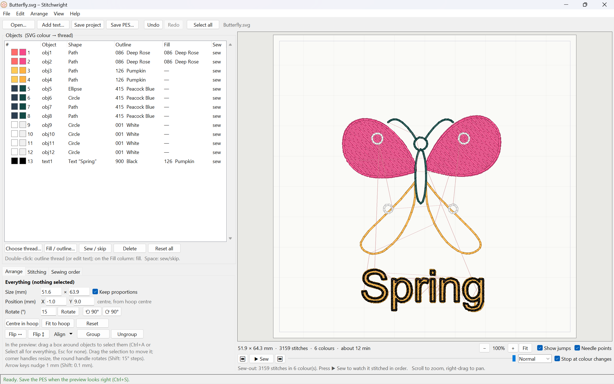

# svg2pes

Turn simple SVG artwork into Brother **.PES** embroidery files, with a desktop window for
choosing thread colours and previewing the stitches.

Built for the **Brother PE540D** (100 × 100 mm / 4" × 4" hoop). Milestone 1 sews
**run-stitch outlines**. Fill and satin stitches are not built yet.

## Features

- Reads SVG shapes (rect, circle, ellipse, polygon, polyline, path), including transforms
  and viewBox units, at their real size in millimetres.
- Gives each object a thread from Brother's 61-colour thread chart (the *Color Thread
  Conversion Chart* in the machine manual). The machine shows the right colour name and
  thread number on screen.
- Colours that come out as the same thread are sewn together, so the machine never stops
  twice for the same spool.
- Orders the outlines to keep jumps short. Each outline gets tie-in and tie-off stitches,
  and no stitch is shorter than 0.4 mm (very short stitches tend to break the thread).
- Centres the design in the hoop, checks it fits (or shrinks it to fit), and checks each file
  after saving by reading it back.
- Comes with a desktop window and a command line. Both use the same conversion code.

## Install

Needs Python 3.10 or newer. Tkinter, which the window uses, comes with Python on Windows and
macOS.

    git clone https://github.com/MRC757/svg2pes.git
    cd svg2pes
    pip install -r requirements.txt

## Using the window

    python -m svg2pes gui                 # or double-click svg2pes_gui.pyw on Windows

1. **Open SVG…** (Ctrl+O). Each object appears with two swatches: its colour in the SVG and
   the Brother thread it will be sewn in.
2. Double-click an object (or select several and press **Choose thread…**) to pick one of the
   61 threads. Tick *Also use it for…* to recolour every object that had the same SVG colour.
   **Sew / skip** (Space) leaves objects out.
3. Set the hoop, margin, width and stitch length. The preview and the **Sewing order** list
   (one row per thread change on the machine) update as you type.
4. **Save PES…** (Ctrl+S). It suggests a short file name without spaces for the USB stick.

## Using the command line

    python -m svg2pes list design.svg            # objects, ids, colours and nearest threads
    python -m svg2pes palette                    # the 61 Brother threads
    python -m svg2pes convert design.svg -o design.pes --preview design.png \
        --set sun=brother:205 --set badge="Sky Blue" --map "#ffffff=Black" --skip wave

| Option | Meaning |
| --- | --- |
| `--set OBJECT=COLOUR` | colour of one object, by SVG id or by its number from `list` |
| `--map OLD=NEW` | recolour every object that uses one SVG colour |
| `--skip OBJECT` | leave an object out |
| `--width MM` | scale the design to this width |
| `--fit` | shrink the design to fit the hoop if it is too big |
| `--hoop WxH` | hoop size in mm (default `100x100`) |
| `--margin MM` | space kept clear inside the hoop (default 2) |
| `--stitch-len MM` | run-stitch length, 0.5–12 (default 2.5) |
| `--keep-order` | keep the SVG drawing order (usually means more colour changes) |
| `--pes-version 1\|6` | PES format version (default 1, tested on the PE540D) |
| `--no-snap` | keep the exact SVG colours instead of Brother threads |

COLOUR can be any of these:
- `#rrggbb`
- a colour name from the chart, such as `Red` or `Sky Blue`
- `brother:<thread number>`, the Embroidery number on the spool (`brother:900` is Black)
- `chart:<row>`, the row number (1–61) in the chart

With `--no-snap` the machine shows the nearest Brother colour name for each thread.

## Trying it on the machine

1. Copy `samples/sample.pes` to a FAT32 USB stick. Use a short file name without spaces.
2. Check that it loads, the size reads about 56 × 36 mm, and 5 colour stops appear.
   `samples/sample.pes` has been checked on a PE540D. `samples/sample_v2.pes` is the same design
   made with the current code, with the sun in 214 Deep Gold.
3. Sew a test on scrap fabric with stabiliser. If a file will not load, try PES version 6.

## Limitations

- Shapes are sewn as outlines only. Filled shapes become outlines, and fill and satin stitches
  come in a later milestone.
- Text, images, gradients and opacity are ignored. Convert text to paths in your drawing
  program first.
- The PE540D has no automatic thread cutter, so it most likely ignores the trim codes written
  for long jumps. Snip those threads by hand after sewing.
- SVGs saved at 72 dpi (some Illustrator exports) come out about 25% smaller than intended.
  Use `--width` or the Width box to set the size.
- Grouping by colour changes the sewing order. With outlines only this hardly matters, but
  once fills arrive, objects that overlap will be sewn in their SVG order.

## Project layout

| Path | What it does |
| --- | --- |
| `svg2pes/svg_import.py` | reads the SVG into objects made of polylines, in mm |
| `svg2pes/palette.py` | the 61 Brother threads and colour parsing |
| `svg2pes/stitching.py` | outline simplification, needle drops, tie stitches, ordering |
| `svg2pes/convert.py` | sizing, colour choices, stitch planning, PES writing and checking |
| `svg2pes/preview.py` | draws the stitch preview |
| `svg2pes/gui.py` | the Tkinter window |
| `svg2pes/cli.py` | the command line |

## Tests

    pip install pytest
    python -m pytest tests

## Built with

[pyembroidery](https://github.com/EmbroidePy/pyembroidery) (PES writing),
[svgelements](https://github.com/meerk40t/svgelements) (SVG parsing), Pillow and NumPy.
Brother and PE540D are trademarks of Brother Industries, Ltd. This project is not affiliated
with Brother.

## License

MIT, see [LICENSE](LICENSE).
